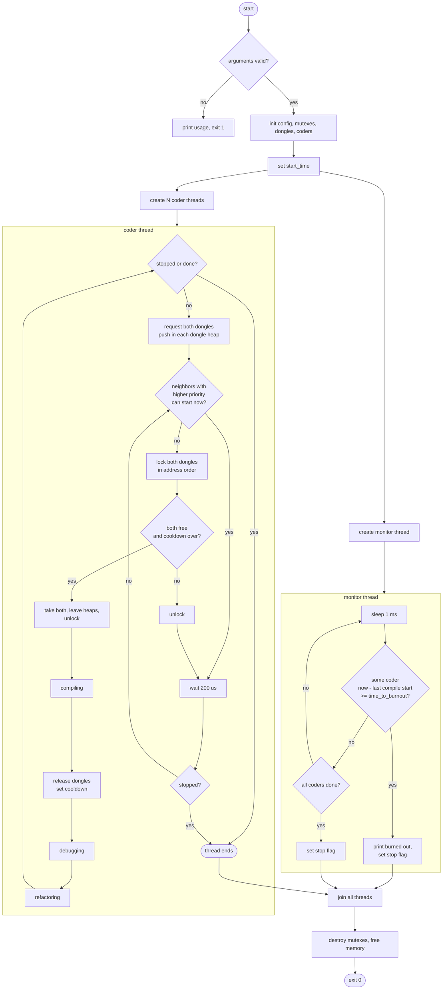

*This project has been created as part of the 42 curriculum by adedias-*

# Codexion

## Description

Codexion is a concurrency simulation written in C with POSIX threads. `N` coders sit in a circle, and between each pair of neighbors there is one USB dongle (so there are also `N` dongles). To compile, a coder needs **both** the dongle on its left and the one on its right. After compiling, the coder debugs, then refactors, then tries to compile again. If a coder goes `time_to_burnout` milliseconds without starting a compile, it burns out and the simulation stops.

The goal is to share a limited resource between threads without deadlock, without starvation, and with accurate timing. A dedicated monitor thread watches the coders and stops the simulation on burnout or when everyone has compiled enough times.

Two schedulers decide who gets a contested dongle:

- `fifo`: first come, first served.
- `edf` (Earliest Deadline First): the coder closest to burning out goes first.

## Instructions

### Build

```bash
make        # builds ./codexion
make clean  # removes object files
make fclean # removes objects and the binary
make re     # fclean + all
```

Compiled with `cc -Wall -Wextra -Werror -pthread`.

### Run

```bash
./codexion number_of_coders time_to_burnout time_to_compile time_to_debug \
           time_to_refactor number_of_compiles_required dongle_cooldown scheduler
```

| Argument | Meaning |
|---|---|
| `number_of_coders` | Number of coders (and dongles). At least 1. |
| `time_to_burnout` | ms a coder can survive without starting a compile. |
| `time_to_compile` | ms spent compiling (holding both dongles). |
| `time_to_debug` | ms spent debugging. |
| `time_to_refactor` | ms spent refactoring. |
| `number_of_compiles_required` | Each coder stops after this many compiles (at least 1). |
| `dongle_cooldown` | ms a dongle stays unavailable after being released. |
| `scheduler` | `fifo` or `edf`. |

All numeric arguments must be non-negative integers that fit in an `int`. Invalid input prints a usage message and exits with code 1.

### Examples

```bash
./codexion 5 800 200 200 200 3 100 fifo   # everyone finishes
./codexion 4 800 200 200 200 3 100 edf    # everyone finishes
./codexion 4 410 200 200 200 3 100 fifo   # impossible timing: someone burns out
./codexion 1 800 200 200 200 3 100 fifo   # one dongle only: the coder burns out
```

### Output format

```
<timestamp_ms> <coder_id> has taken a dongle
<timestamp_ms> <coder_id> is compiling
<timestamp_ms> <coder_id> is debugging
<timestamp_ms> <coder_id> is refactoring
<timestamp_ms> <coder_id> burned out
```

Timestamps are milliseconds since the simulation started.

### Project layout

```
include/codexion.h   structs and prototypes
src/main.c           entry point
src/parsing/         argument validation and config filling
src/init/            data, dongles and coders initialization
src/simulation/      thread creation and joining
src/coder/           coder routine and its actions
src/dongle/          taking, dropping, queueing dongles
src/monitor/         burnout monitor thread
src/scheduler/       priority comparison and the binary heap
src/utils/           time and log helpers
src/cleanup.c        resource release
```

## Program flow



## Blocking cases handled

### Deadlock

Deadlock needs the four Coffman conditions at the same time. The solution breaks two of them.

| Coffman condition | Status | How |
|---|---|---|
| Mutual exclusion | Kept | A dongle is used by one coder at a time. This is the problem itself. |
| Hold and wait | **Broken** | A coder takes **both dongles or none**. While it waits, it holds no dongle, so nobody can be blocked by a half-served neighbor. |
| No preemption | Kept | Nobody takes a dongle away from a coder who is compiling. |
| Circular wait | **Broken** | Dongle mutexes are always locked in address order (lowest address first), so a cycle of waiting locks cannot form. |

Without this, the classic failure happens: with 5 coders, each one picks up its left dongle and waits forever for its right one.

A single coder (`N = 1`) has only one dongle for both hands. It takes it, can never take a second one, and burns out. The code handles this case explicitly so that it does not lock the same mutex twice.

### Starvation

Each dongle has a small priority queue (a binary heap with capacity 2, since only its two neighbors can ask for it). A coder registers in the heap of both of its dongles before waiting.

- `fifo`: priority is the arrival ticket. Lower ticket goes first.
- `edf`: priority is the deadline, `last_compile_start + time_to_burnout`. The earliest deadline goes first.
- Ties are always broken by the lower `coder_id`.

A coder only gets blocked by a neighbor that is **ahead of it in the queue and could actually start right now** (both of the neighbor's dongles are free). A neighbor that is ahead in the queue but is itself waiting for its other dongle does not block anybody. This avoids a coder waiting for nothing and lets the pairs `{1,3}`, then `{2,4}` alternate with 4 coders.

### Cooldown

When a coder releases a dongle, the dongle stores `now + dongle_cooldown` as the instant it becomes available again. A dongle counts as free only if it is not in use **and** the current time is at or after that instant. No thread sleeps for the cooldown; the check is done at take time.

### Precise burnout detection

The monitor thread wakes up every 1 ms and checks, for each coder, `now - compile_start >= time_to_burnout`. `compile_start` is read under `state_mutex`. The burnout message is printed **before** the stop flag is set, so it is the last line of the log, and it appears within a few milliseconds of the real deadline (the requirement is 10 ms).

Coders also use `smart_sleep`, which sleeps in short steps (300 us) and checks the clock, instead of one long `usleep` that could overshoot.

### Log serialization

Every message goes through `log_state`, which locks `log_mutex`, checks the stop flag, prints one full line with a single `printf`, and unlocks. Two threads never interleave characters, and nothing is printed after the simulation stopped (except the final burnout line, which is printed first by design).

## Thread synchronization mechanisms

Only `pthread_mutex_t` is used to protect shared data. `pthread_cond_t` is initialized in each dongle and destroyed in cleanup, but the waiting is done by polling (`usleep(200)`), because the wait condition depends on several things at once (two dongles, two neighbors, cooldown time, stop flag) and a timed poll is simpler to get right than a condition variable for each combination.

| Mutex | Protects | Used by |
|---|---|---|
| `log_mutex` | `printf` output | all coders, monitor |
| `stop_mutex` | the `stop` flag | all coders, monitor |
| `state_mutex` | each coder's `compile_count` and `compile_start` | coders (write), monitor (read) |
| `dongle[i].mutex` | `dongle_data`, `dongle_cooldown`, the heap and `next_ticket` of dongle `i` | coders |

### Lock order

Locks are always taken in this order, so they cannot deadlock each other:

1. `log_mutex` then `stop_mutex` (inside `log_state` and `is_stopped`).
2. dongle mutex then `stop_mutex`.
3. Two dongle mutexes: lowest address first (`lock_pair`).
4. `state_mutex` is never held together with a dongle mutex (`deadline_of` takes and releases it before any dongle lock).

### Examples of race conditions prevented

**Two coders taking the same dongle.** The check "is free" and the write "mark as busy" happen inside `try_take`, with both dongle mutexes held. Without the lock, two neighbors could both see the dongle free and both take it.

**Monitor reading while a coder updates.** `compile_start` is written by the coder at the start of a compile and read by the monitor every millisecond. Both access it under `state_mutex`, so the monitor never reads a half-written `long`.

**Stop flag.** The monitor sets `stop` under `stop_mutex`. Coders read it through `is_stopped`, which also locks `stop_mutex`. This way every coder sees the stop within one polling step, even when it is waiting for a dongle.

**Advisory reads.** The neighbor check (`blocked_by_neighbor`) is only a hint to avoid useless attempts. The final decision is always taken again in `try_take`, with the dongle mutexes held. A stale hint can cost one extra polling step, but cannot break correctness.

### Coder to monitor communication

- Coder to monitor: through `state_mutex` data (`compile_start`, `compile_count`). The monitor never talks to a coder directly.
- Monitor to coder: through the `stop` flag. After the flag is set, every coder leaves its loop, and `main` joins all threads and frees everything.

### Verification

- `valgrind --leak-check=full`: no leaks, no errors.
- `valgrind --tool=helgrind`: no data races reported.
- Repeated runs (stress loops) of `4 800 200 200 200 3 100` with both schedulers finish with no burnout; `4 410 ...` and `3 800 ...` correctly burn out because their timing is impossible.

## Resources

### References

- POSIX Threads Programming (Lawrence Livermore National Laboratory): https://hpc-tutorials.llnl.gov/posix/
- `man pthread_create`, `pthread_mutex_lock`, `pthread_cond_wait`, `gettimeofday`, `usleep`
- Dijkstra, *Hierarchical ordering of sequential processes* (dining philosophers and resource ordering)
- Coffman, Elphick, Shoshani, *System Deadlocks* (1971): the four conditions for deadlock
- Liu and Layland, *Scheduling Algorithms for Multiprogramming in a Hard Real-Time Environment* (1973): Earliest Deadline First
- Binary heap (array representation): any algorithms textbook, e.g. Cormen et al., *Introduction to Algorithms*, chapter 6

### How AI was used

I used Claude (Anthropic) as a tutor and reviewer during the project.

- **Learning and explanation:** understanding mutexes, condition variables, race conditions, deadlock and the Coffman conditions, and how to structure the files under the Norm limits.
- **Code review:** I wrote most of the early code (header, parsing, validation, init, time and log helpers, coder actions, monitor), and Claude reviewed it, pointed out bugs (uninitialized variables, off-by-one errors, wrong types) and norminette problems.
- **Test writing:** the unit tests I used locally (not part of this repository) were written with Claude's help.
- **Dongle algorithm:** after my first version with simple queues still deadlocked or starved in some cases (for example `4 800 200 200 200 3 100`), the final dongle logic (take both or none, address-ordered locking, neighbor eligibility rule) and the argument limits check were implemented by Claude. I reviewed it, ran it, and tested it with valgrind and helgrind.
- **README:** drafted with Claude and reviewed by me.

I understand and can explain every part of the code in this repository.